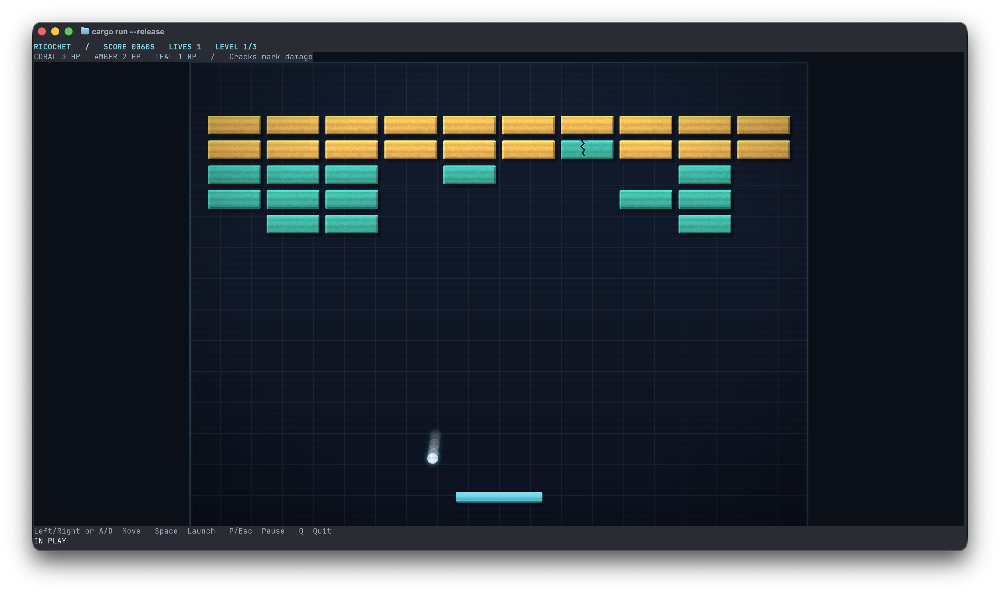

# Ricochet

[](https://www.rust-lang.org/)
[](https://ghostty.org/)
[](https://sw.kovidgoyal.net/kitty/graphics-protocol/)
[](https://ghostty.org/docs/install/release-notes/1-4-0)
[](LICENSE)

<p align="center">
  
  <br />
  <em>Ricochet 0.2.0 gameplay.</em>
</p>

Breakout in your terminal, with pixel graphics, smooth motion and deterministic
gameplay. Clear three levels with three lives, using arrows or A/D to steer.
The playfield uses Kitty graphics; scores, controls and state messages remain
ordinary terminal text.

## New in 0.2.0

- Anti-aliased procedural art: gradient bricks, bevels, damage cracks, shadows,
  ball glow, a grid background and a scanline/vignette overlay.
- Ball trails, hit flashes, brick shatter, debris, paddle squash and screen shake,
  plus a pixel-font title and state banners.
- `--fx full|reduced|off`, so you can reduce motion and terminal output or keep
  only the static artwork. All modes retain the same gameplay.
- Compressed sprite atlases and a scale cap of **3 physical pixels per logical
  unit** when zlib uploads are available; otherwise uploads remain uncompressed
  and the cap stays at **2**. The playfield stays centred and letterboxed.

All artwork and lettering are generated in Rust, with no external assets. Physics
still runs at 120 Hz, independently of the selected 30 or 60 FPS render rate.

## Run

Requires **Ghostty 1.4+ on macOS or Linux**, interactive stdin/stdout, and Rust
**1.94 or newer** (edition 2024). Implementation toolchain: Rust 1.99.0; the
declared 1.94 minimum was also compiled and tested. No external assets or runtime
services are needed.

```sh
cargo run --release
cargo run --release -- --fps 30
cargo run --release -- --fx reduced
cargo run --release -- --fx off
cargo run -- --help
cargo run -- --version
```

The defaults are **60 FPS** and **full effects**. Use `--fx reduced` for fewer
particles, a shorter trail and no shake or overlay; `--fx off` keeps the new art
and static banners without transient effects.

Use at least **80 columns × 30 rows**, with enough physical pixels for a
**400 × 300** playfield after reserving four text rows. A larger window improves
detail. Resize suspension preserves progress; press **P** or **Esc** after
restoring a playable size. A focus change pauses an active run and never resumes
it automatically.

The startup probe checks actual Kitty graphics support and enhanced keyboard
flags **1 + 2 + 8**, including ordinary-letter release events. Beyond the image
query, it uploads a transparent 1 × 1 test image and places it by image number
with pixel offsets, exactly as sprites are placed; the placement reply must name
the image. Partial implementations (iTerm2 3.7.6 acknowledges such placements
without drawing them) exit cleanly with **Full Kitty compatibility required**,
followed by the terminal's XTVERSION name and the failed check. An additional bounded probe
checks zlib uploads; rejection or no reply selects uncompressed uploads and a
2.0 scale cap, without preventing startup. `TERM`/`TERM_PROGRAM` and the
XTVERSION name are not used as capability evidence.

## Why Ghostty?

Ricochet targets Ghostty 1.4+ and uses the Kitty protocols for both graphics and
input. RGBA sprites and within-cell pixel offsets let the ball move smoothly
between character cells. Enhanced keyboard reporting supplies press, repeat and
release events for arrows and ordinary letters, so held A/D movement stops when
you release the key.

Cached images, atlas source rectangles and placement diffing keep animation
traffic small. Synchronized updates, when supported, group each frame into one
visible update. Startup checks capabilities instead of relying on the terminal's
name. Native visual and input acceptance is tracked separately in the
[verification report](verification/REPORT.md).

## Controls

| Key | Action |
| --- | --- |
| Left / A | Move left while held |
| Right / D | Move right while held |
| Space | Start from Title; launch from Ready |
| P / Esc | Pause or resume |
| R | New run from Paused, Won or GameOver |
| Q / Ctrl-C | Quit from any state |

Both directions cancel. A and Left (and D and Right) are tracked independently.
Repeated one-shot keys are ignored. A lost life keeps score, brick damage and
speed; a new level keeps score/lives and resets speed. Launches alternate right
and left. Clear all three levels to win.

## Artwork and effects

All images and the embedded 5×7 pixel alphabet are generated in Rust. Anti-aliased
edges, gradients, bevels, geometric cracks, shadows and ball glow remain enabled
in every mode. Cached atlases supply animation frames through source rectangles;
changing a frame sends a placement command and never uploads new image data.

`--fx full|reduced|off` defaults to `full`. Gameplay is identical in all modes,
at either render rate and at every playable viewport size.

| Feature | full | reduced | off |
| --- | --- | --- | --- |
| New art, shadows, glow, static logo/banners | Yes | Yes | Yes |
| Logo sweep, banner fade, hit flash, shatter, paddle squash | Yes | Yes | No |
| Debris | 96 chips; 10 per destruction / 4 per hit | 32 chips; 4 / 2 | No |
| Ball trail | Up to 8 ghosts | Up to 3 | No |
| Shake and scanline/vignette overlay | Yes | No | No |

Effects use their own clock, capped at 50 ms per rendered frame, with fixed
1/120-second particle integration and deterministic event seeds. Pause, a small
viewport and pending explicit resume freeze effects. Resizing preserves their
logical positions; restart and a new level clear them. Graphical banners add to
the ordinary text HUD, including READY, level changes, PAUSED and end states.

## Implementation

- `game.rs`, `levels.rs`, `constants.rs`: explicit states and deterministic rules
  in an 800 × 600 logical world. All gameplay constants match [the baseline spec](specs/SPEC-init-001.md).
- `physics.rs`: continuous circle/rectangle face and rounded-corner collision
  detection. The moving paddle is swept up to its wall clamp, then treated as
  stationary. Top contacts use the specified ±65° angle and horizontal minimum.
  Simultaneous collinear contacts share one normal; independent simultaneous
  normals reverse each axis once. Distinct bricks take damage once per event.
  Separation is 0.0001 logical units; collision iterations are capped at 16.
- `timing.rs`, `input.rs`, `app.rs`: 120 Hz fixed simulation, independent 30/60 Hz
  rendering, 100 ms stall clamp and 12 ticks per iteration. Input waits use
  Crossterm polling. Discontinuities reset elapsed time and held input.
- `terminal.rs`: one bounded raw startup reader extracts protocol replies and
  preserves intervening game inputs. Crossterm 0.29 does not expose Kitty APC
  replies publicly. After negotiation only Crossterm reads input; pixel geometry
  is read through its OS `TIOCGWINSZ` wrapper every 250 ms and on resize events.
- `physics.rs` and `game.rs` return ordered contact and transition events;
  events are never stored in simulation state. `Controller` retains the newest
  256 notifications and drains them once per rendered frame. Input actions return
  launch/restart notifications immediately; physics ticks return contacts and
  life/level/end transitions.
- `render/fx.rs`: logical effect positions and fixed pools; no Kitty commands.
- `render/sprites.rs`, `render/font.rs`: adaptive 4×4 edge coverage, straight RGBA,
  padded atlases and generated lettering. `flate2` uses only its pure Rust
  backend; no image, font or randomness dependency is needed.
- `render/`: seven cached images in full mode (six in reduced/off), below the
  **16-image / 192-placement** registry limits. Fixed IDs cover background 1,
  bricks 2–51, paddle 52, ball 53, trail 54–61, shatter 62–69, chips 70–165,
  banners 166–167 and overlay 168. Exhausted effect pools reuse the oldest slot.
  All nine z-layers stay inside the graphical playfield. Placement diffing emits
  only changes; ordinary text HUD lines also update only when changed. Frames
  are batched and flushed once, with guarded synchronized updates when supported.

Scale is uniform, capped at **3 physical pixels per logical unit with compression**
(**2 without it**), and centred with letterboxing. The complete scale-3 decoded
image set stays below 64 MiB. Uploads use zlib before base64 with 4096-byte chunks.
Images regenerate on geometry changes. Source rectangles clip every sprite,
including ball glow and ghosts at the open bottom, before the footer. Shake is
limited by the available letterbox margins on each side. Cleanup cancels partial
protocol strings, removes owned images, restores
keyboard/focus/cursor/screen/colours and raw mode, then reports errors. Panics
unwind through the same guard. SIGINT, SIGTERM, SIGHUP, SIGQUIT and SIGTSTP notify
the loop through atomic flags, without terminal I/O inside signal handlers.

## Validation and diagnostics

```sh
cargo fmt --check
cargo clippy --all-targets -- -D warnings
cargo test
cargo test --features dev-harness
cargo build --release
```

Tests run without a terminal. They cover collisions (including true corner
arcs, simultaneous contacts and maximum speed), paddle motion, scoring, state
transitions, focus/resize suspension, equivalent 30/60 FPS histories, startup
input replay, pixel mapping, chunk boundaries, bounded ownership and cleanup.
A repeated 72,000-tick deterministic simulation checks finite, moving states.

The optional development harness is absent from the normal game CLI:

```sh
# Move the diagnostic ball with A/D or arrows; watch the release counter.
# Resize quits this diagnostic; rerun it at the new size.
cargo run --release --features dev-harness --example terminal_spike

# End-state, damaged-brick and controlled error/panic acceptance screens.
cargo run --release --features dev-harness --example acceptance -- won
cargo run --release --features dev-harness --example acceptance -- game-over
cargo run --release --features dev-harness --example acceptance -- damaged

# An 11-second repeating presentation scene: logo, all banners, damage,
# destruction, chips, trail, squash, shake, and an automatic mid-shatter pause.
# Q quits; P pauses; resizing below minimum requires P to resume.
cargo run --release --features dev-harness --example acceptance -- effects
cargo run --release --features dev-harness --example acceptance -- effects --fx reduced
cargo run --release --features dev-harness --example acceptance -- effects --fx off
cargo run --release --features dev-harness --example acceptance -- error
cargo run --release --features dev-harness --example acceptance -- panic

# Synthetic PTY protocol/lifecycle checks (Python 3, standard library only).
cargo build --release --examples --features dev-harness
cargo build --release
python3 tools/verify_pty.py --output verification/pty-results.json
cargo test --all-features

# No-terminal release measurements: decoded memory, complete upload bytes,
# regeneration time and 600 rendered frames under maximum effects load.
cargo run --release --features dev-harness --example visual_metrics
```

The PTY harness supplies synthetic capability/key/focus/resize responses and
models resource ownership. **It does not establish Ghostty compatibility.**
See [verification/REPORT.md](verification/REPORT.md) for measured budgets, the
shipped atlas path and remaining real-terminal acceptance. The release implements
[SPEC-evolve-002.md](specs/SPEC-evolve-002.md); automated checks and offline artwork
inspection do not establish native Ghostty visual or input acceptance.

## Limits

Nonzero OS pixel geometry is required; terminals that do not provide it are
rejected. There is no terminal-query fallback after input ownership passes to
Crossterm, and no font aspect ratio is assumed. Suspend/resume is unsupported:
SIGTSTP exits cleanly and Ctrl-Z is ignored in raw mode. SIGKILL and process abort
cannot restore the terminal. Windows, tmux/screen/SSH guarantees, sound, mouse,
saved scores and configuration files are outside this release's scope.

## Protocol references

- [Kitty graphics protocol](https://sw.kovidgoyal.net/kitty/graphics-protocol/)
- [Kitty keyboard protocol](https://sw.kovidgoyal.net/kitty/keyboard-protocol/)
- [Crossterm 0.29 events](https://docs.rs/crossterm/0.29.0/crossterm/event/index.html)
- [Ghostty 1.4 release notes](https://ghostty.org/docs/install/release-notes/1-4-0)

## Principles of Participation

Everyone is invited and welcome to contribute: open issues, propose pull requests, share ideas, or help improve documentation. Participation is open to all, regardless of background or viewpoint. 

This project follows the [FOSS Pluralism Manifesto](./FOSS_PLURALISM_MANIFESTO.md), which affirms respect for people, freedom to critique ideas, and space for diverse perspectives. 

## License and Copyright

Copyright (c) 2026, Iwan van der Kleijn

This project is licensed under the MIT License. See the [LICENSE](LICENSE) file for details.
